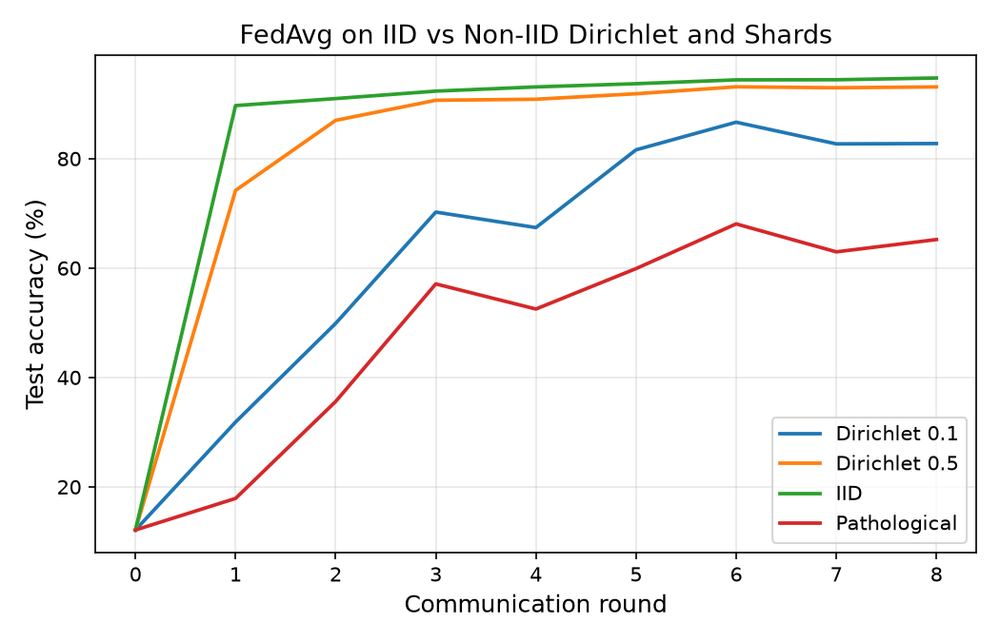
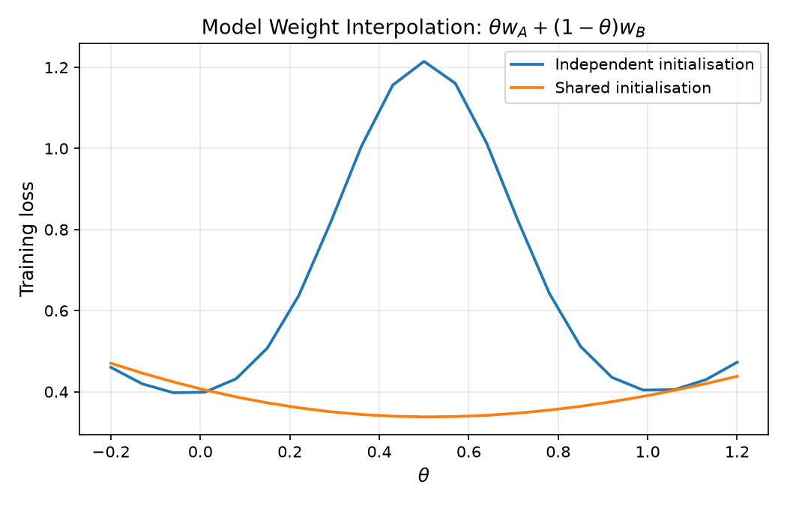

# fl-lab

Implementation and empirical reproduction of two foundational federated learning papers:

1. **FedAvg**: [Communication-Efficient Learning of Deep Networks from Decentralized Data](https://arxiv.org/abs/1602.05629) (McMahan et al., AISTATS 2017)
2. **FL Survey & Taxonomy**: [Advances and Open Problems in Federated Learning](https://arxiv.org/abs/1912.04977) (Kairouz et al., 2021)

---

## Structure

```
fl-lab/
├── notebooks/
│   ├── 01_data_and_partitions.ipynb
│   ├── 02_centralized_baseline.ipynb
│   ├── 03_fedsgd_fedavg.ipynb
│   ├── 04_noniid.ipynb
│   ├── 05_common_init.ipynb
│   ├── 06_survey_demos.ipynb
│   └── 07_plots.ipynb
├── src/
│   ├── partition.py     # iid, shards, dirichlet, quantity skew, feature skew
│   ├── models.py        # TwoNN (199,210 params) and CNN (1,663,370 params)
│   ├── fl.py            # client_update, fedavg_round, run_fl
│   ├── utils.py         # seeding, tensor loading, evaluate, param count
│   └── plots.py         # plotting functions reading from results/
├── results/             # experiment logs (.csv)
├── plots/               # generated figures (.png)
├── requirements.txt
├── LOG.md
└── README.md
```

## Setup

```bash
pip install -r requirements.txt
```

## Running

Launch Jupyter or run notebooks directly:

```bash
jupyter notebook notebooks/
```

Notebook flow:
- `01_data_and_partitions.ipynb`: downloads MNIST and builds partition files in `data/`.
- `02_centralized_baseline.ipynb`: trains TwoNN and CNN baselines.
- `03_fedsgd_fedavg.ipynb`: evaluates client fraction $C$, local epochs $E$, and batch size $B$.
- `04_noniid.ipynb`: compares IID, pathological shards, and Dirichlet splits.
- `05_common_init.ipynb`: verifies model weight interpolation (Paper 1 Figure 1).
- `06_survey_demos.ipynb`: cross-silo vs cross-device, client dropouts, communication volume, and client drift.
- `07_plots.ipynb`: loads CSVs from `results/` and generates all figures into `plots/`.

## Key Findings

### Local Computation Accelerates Convergence
Increasing local epochs $E$ and using mini-batches $B$ reduces the number of communication rounds needed:


### Non-IID Data and Client Drift
Pathological shards and high label skew slow convergence and cause update variance across clients:



### Common vs Independent Initialisation
Models averaged from a shared initialisation point interpolate smoothly with low loss, while models trained from independent starts encounter a severe barrier:


