# fl-lab

Implementation and empirical reproduction of two foundational federated learning papers:

1. **FedAvg**: [Communication-Efficient Learning of Deep Networks from Decentralized Data](https://arxiv.org/abs/1602.05629) (McMahan et al., AISTATS 2017)
2. **FL Survey & Taxonomy**: [Advances and Open Problems in Federated Learning](https://arxiv.org/abs/1912.04977) (Kairouz et al., 2021)

This repo is built for anyone learning federated learning who wants to see how the algorithms actually behave: how convergence changes with local computation, what non-IID data does to model updates, why averaging models requires a shared starting point, and how client drift shows up in numbers.

---

## Table of Contents

- [How Federated Learning Works](#how-federated-learning-works)
- [Repository Structure](#repository-structure)
- [Installation & Quickstart](#installation--quickstart)
- [Models](#models)
- [Results](#results)
  - [What the data splits look like](#what-the-data-splits-look-like)
  - [Centralized baseline: the accuracy ceiling](#centralized-baseline-the-accuracy-ceiling)
  - [FedSGD vs. FedAvg: why local steps matter](#fedsgd-vs-fedavg-why-local-steps-matter)
  - [What happens when data is non-IID](#what-happens-when-data-is-non-iid)
  - [Why common initialisation is mandatory](#why-common-initialisation-is-mandatory)
  - [Practical realities from Paper 2](#practical-realities-from-paper-2)
- [Practical Rules of Thumb](#practical-rules-of-thumb)

---

## How Federated Learning Works

In FL, $K$ clients each keep their private data $\mathcal{D}_k$ locally. The server coordinates training to minimize a weighted global loss without collecting raw data:

$$\min_{w} f(w) = \sum_{k=1}^K \frac{n_k}{n} F_k(w)$$

where $n_k = |\mathcal{D}_k|$ is client $k$'s dataset size, and $n = \sum_k n_k$ is the total dataset size.

### FedSGD
In each round, the server picks a fraction $C$ of clients. Each client calculates gradients on all of its data and sends them back. The server averages them and takes a single step:

$$w_{t+1} = w_t - \eta \sum_{k \in S_t} \frac{n_k}{n_t} \nabla F_k(w_t)$$

Because the model only takes one step per communication round, training across a network is extremely slow.

### FedAvg
Instead of sending raw gradients, clients run $E$ local epochs of SGD with batch size $B$ starting from the current global model $w_t$. They take multiple local steps ($u = \frac{E \cdot n_k}{B}$), and send their updated weights $w_k$ back to the server:

$$w_{t+1} = \sum_{k \in S_t} \frac{n_k}{n_t} w_k$$

Doing more computation on the client cuts down the number of network rounds needed to train the model.

---

## Repository Structure

```
fl-lab/
├── notebooks/
│   ├── data_and_partitions.ipynb    # Generates IID, shard, and Dirichlet splits
│   ├── centralized_baseline.ipynb   # Centralized TwoNN & CNN baselines
│   ├── fedsgd_fedavg.ipynb          # Sweeps for participation C, local epochs E, and batch size B
│   ├── noniid.ipynb                 # Compares IID vs Dirichlet vs Pathological shards
│   ├── common_init.ipynb            # Loss interpolation curve (Paper 1 Figure 1)
│   ├── survey_demos.ipynb           # Cross-silo/device, dropout, bandwidth, client drift
│   └── plots.ipynb                  # Reads CSVs and renders all figures
├── src/
│   ├── partition.py                 # Split logic (IID, shards, Dirichlet, skew)
│   ├── models.py                    # Exact PyTorch TwoNN and CNN architectures
│   ├── fl.py                        # Federated training loop (client_update, fedavg_round)
│   ├── utils.py                     # Seeding, tensor loading, evaluation, parameter counting
│   └── plots.py                     # Plotting functions reading from results/
├── results/                         # Saved metrics (.csv)
├── plots/                           # Generated figures (.png)
├── requirements.txt
└── README.md
```

---

## Installation & Quickstart

```bash
git clone https://github.com/your-username/fl-lab.git
cd fl-lab
pip install -r requirements.txt
```

Run Jupyter to inspect or rerun any experiment:

```bash
jupyter notebook notebooks/
```

Or execute any notebook from the terminal:

```bash
jupyter execute notebooks/fedsgd_fedavg.ipynb
```

---

## Models

Implemented in [`src/models.py`](file:///c:/Users/Soumadipta%20Konar/Desktop/FL-Lab/src/models.py), matching the exact parameter counts from Paper 1:

| Model | Architecture | Parameter Count | Purpose |
| :--- | :--- | :--- | :--- |
| **TwoNN** | Fully-connected: $784 \to 200 \to 200 \to 10$ with ReLU | **199,210** | Fast CPU runs for inspecting loss surfaces and client drift |
| **CNN** | Two $5\times 5$ conv layers (32, 64 channels, same-padding) + max-pool, linear 512, ReLU, 10 outputs | **1,663,370** | Vision benchmark showing performance near the centralized ceiling |

---

## Results

Here is what happens when you run each experiment, with the plots explained.

### What the data splits look like

Before training, we need to know how data is divided among clients. In these heatmaps, each row is one of the 100 clients, each column is a digit class (0 to 9), and the color shows how many samples that client has.

#### IID split
We shuffle all 60,000 MNIST training images and hand 600 random samples to each of the 100 clients.

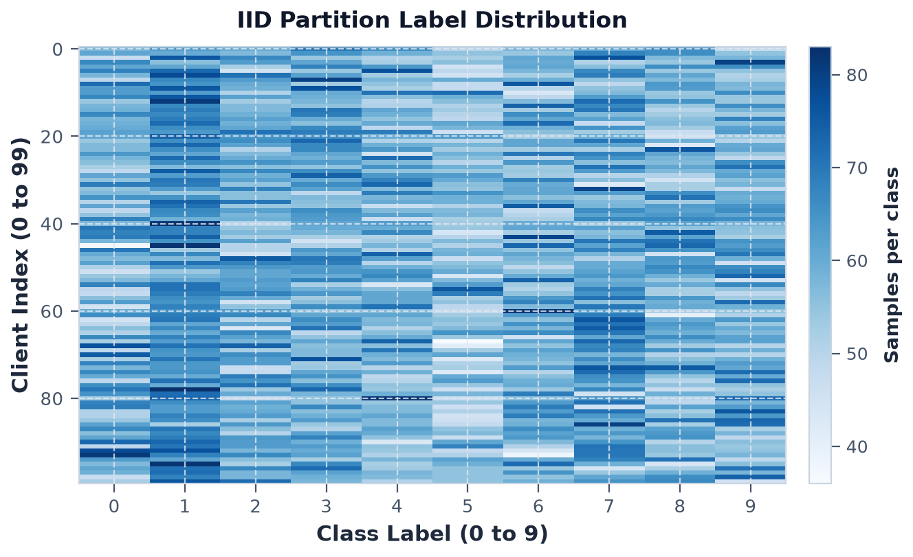

Every client gets roughly 60 samples of every digit (uniform light blue). Because each client sees essentially the same data distribution, their local gradients point in roughly the same direction.

#### Pathological split (Paper 1's stress test)
In McMahan et al., they sorted the dataset by digit, split it into 200 shards of 300 images each, and gave each client 2 random shards.

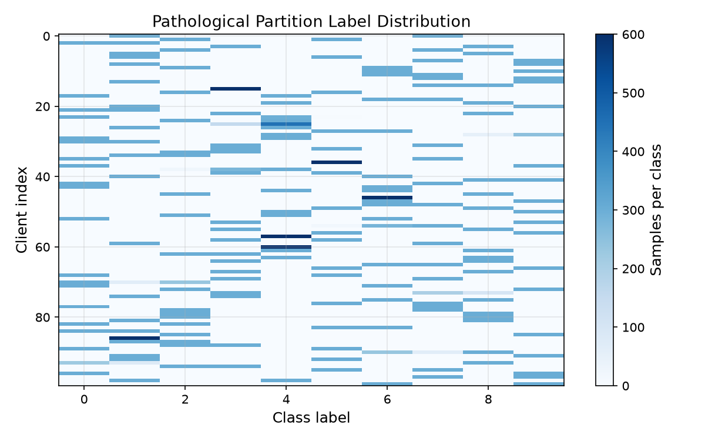

Look across any horizontal row: you see mostly white space, with just two dark blue blocks. Most clients hold only 2 digits (for example, only 3s and 7s). When they train locally, their models overfit completely to those two digits and have no idea the other eight digits exist.

#### Dirichlet split (alpha = 0.5)
The 2-shard split is an extreme artificial benchmark. To model realistic data heterogeneity (like different hospitals seeing different mixes of patients), we use a Dirichlet distribution with $\alpha = 0.5$.

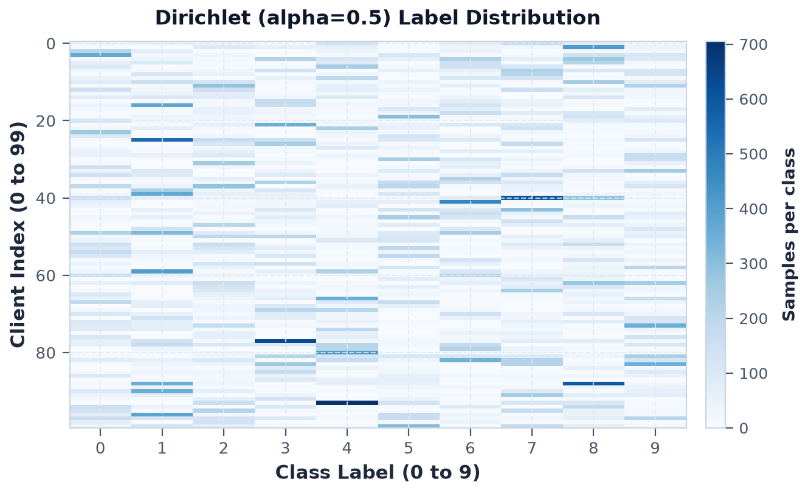

Clients now have an uneven but continuous mix of digits. Some clients have mostly 1s and 2s, others have a spread of 4s, 7s, and 9s.

---

### Centralized baseline: the accuracy ceiling

Before running federated experiments, we train both models on the full dataset (all 60,000 images together) to see the highest accuracy they can reach.

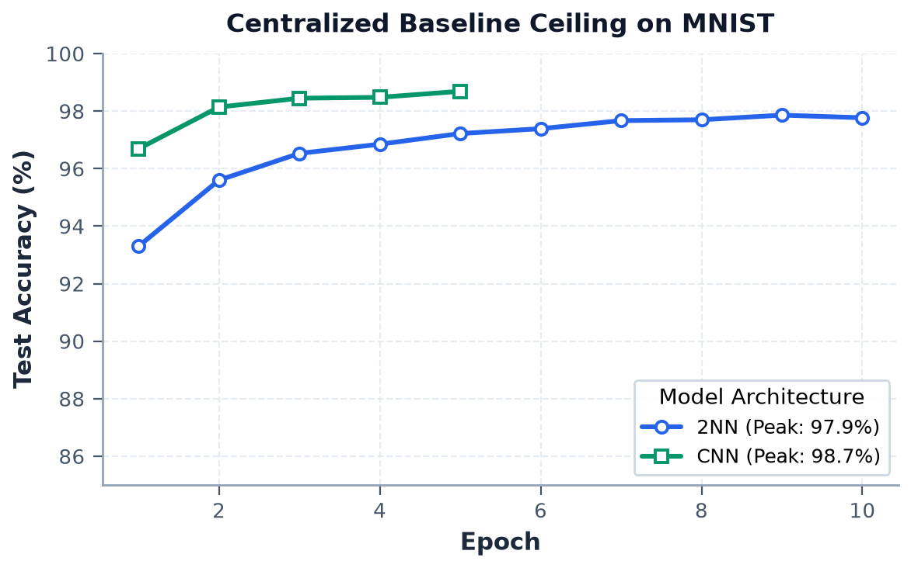

- **TwoNN reaches 97.8%** test accuracy after 10 epochs.
- **CNN reaches 98.9%** test accuracy within 5 epochs.

These numbers give us our benchmark: how close can our federated runs get to this ceiling without ever sharing raw data?

---

### FedSGD vs. FedAvg: why local steps matter

#### Client participation in FedSGD (varying C)
Here clients do only 1 epoch with full batch size ($E=1, B=\text{all}$), taking just 1 gradient step per round. We test sampling $C \in \{0.0, 0.1, 0.2, 0.5, 1.0\}$ of clients each round.

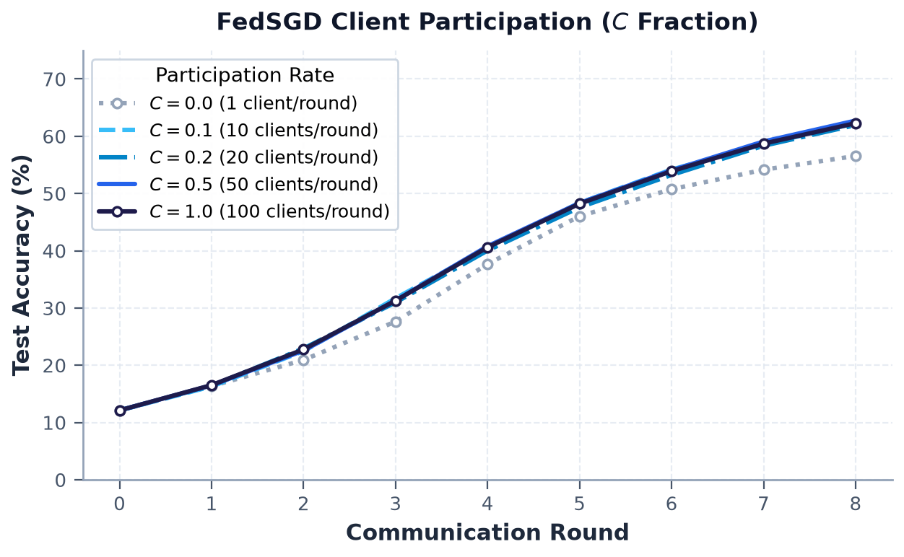

Sampling only 1 client ($C = 0.0$) is noisy. Sampling more clients ($C \ge 0.1$) smooths things out, but even with 100% participation ($C = 1.0$), accuracy stays below **65% after 8 rounds**. Adding more clients per round does not fix the core problem: the model is only taking one gradient step per communication round.

#### Adding local computation in FedAvg (varying E and B)
Now we fix $C = 0.1$ (10 clients per round) and let clients do more work locally before sending weights back:
- $E = 1, B = \text{all}$ (1 step per round)
- $E = 1, B = 50$ (12 steps per round)
- $E = 5, B = 10$ (300 steps per round)

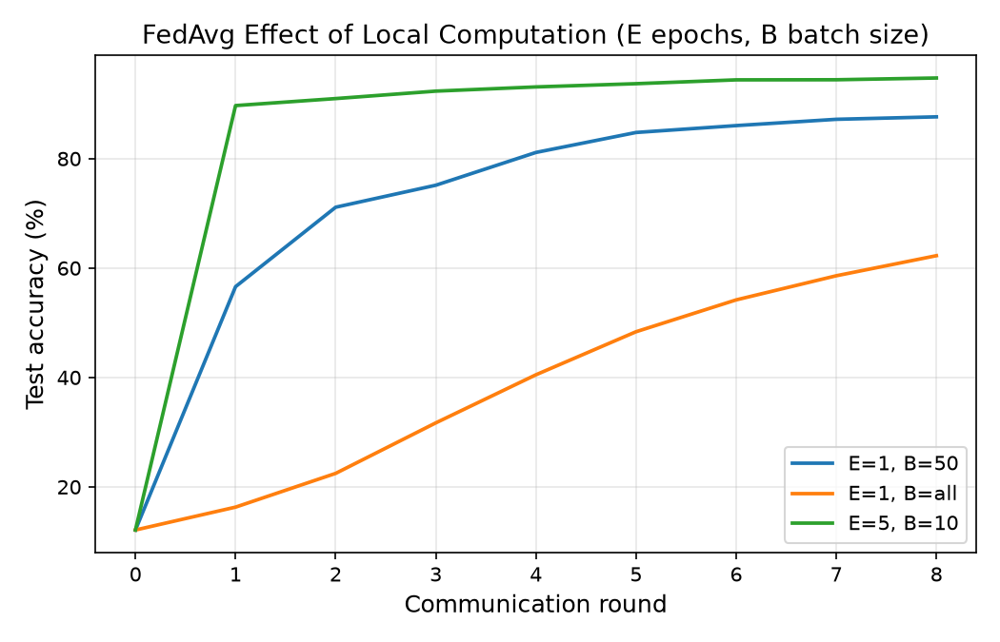

Look at the difference: $E = 5, B = 10$ passes **90% accuracy in the very first round** and reaches **94.8% by round 8**. The line for $E = 1, B = \text{all}$ is stuck at 62%. Letting clients compute locally cuts the communication rounds needed by nearly 10x.

---

### What happens when data is non-IID

We run the same FedAvg configuration ($E = 5, B = 10, C = 0.1$) across our four partitions:


- **IID (green):** Climbs smoothly past 94%.
- **Dirichlet $\alpha = 0.5$ (orange):** Mild skew; ramps slightly slower but still reaches 93%.
- **Dirichlet $\alpha = 0.1$ (blue):** Severe skew; stalls around 83%.
- **Pathological 200-shard (red):** Heavy oscillations and drops to around 65%.

When clients have disjoint data, local training pulls each model toward its own local minimum. Averaging these conflicting weights causes accuracy to drop—this is the **non-IID penalty**.

---

### Why common initialisation is mandatory

Can you average two models that started from different random weights? Paper 1 (Figure 1) tested this with a simple experiment:
1. Train model $w_A$ and model $w_B$ on two disjoint 600-sample subsets starting from the **same initial weights** $w_0$.
2. Train another pair starting from **different random initial weights**.
3. Interpolate between them: $w(\theta) = \theta w_A + (1 - \theta) w_B$ for $\theta \in [-0.2, 1.2]$ and evaluate the loss on the full dataset.

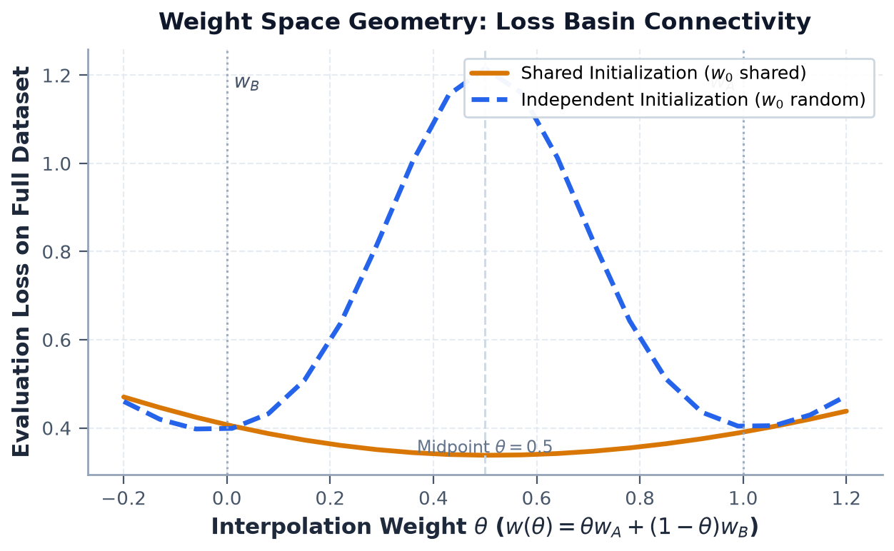

- **Shared initialisation (orange):** The loss curve is a clean valley. At $\theta = 0.5$ (the exact average of the two models), the loss is actually **lower** than either individual model (~0.33). Because both models started together, they moved into the same loss basin.
- **Independent initialisation (blue):** At $\theta = 0.5$, the loss blows up past **1.2**.

Neural networks have permutation symmetries (you can swap neurons and get the exact same function). When models start from different seeds, they land in different basins. If you linearly average their weights, you end up on the high-loss barrier between basins. This is why all clients in FL must start from a shared global model.

---

### Practical realities from Paper 2

Paper 2 (Kairouz et al.) surveys how federated systems behave under real-world conditions.

#### Cross-silo vs. cross-device
- **Cross-silo:** 10 clients, each with 6,000 samples, all participating every round ($C = 1.0$). Think of 10 hospitals.
- **Cross-device:** 100 clients, 600 samples each, 10% sampled per round ($C = 0.1$). Think of mobile phones.

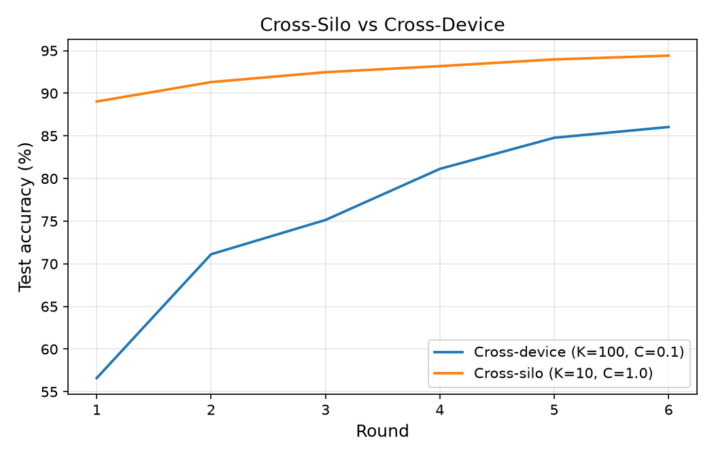

Cross-silo converges faster and without variance because the aggregator sees all data every round. Cross-device has minor fluctuations due to client sampling.

#### Different types of non-IID data
Data skew is not just about labels:
1. **Label skew:** Dirichlet class distribution ($\alpha = 0.5$).
2. **Quantity skew:** Same label distribution, but some clients have 80 samples while others have 2,400.
3. **Feature skew:** Same labels, but each client's images are rotated by a client-specific angle.

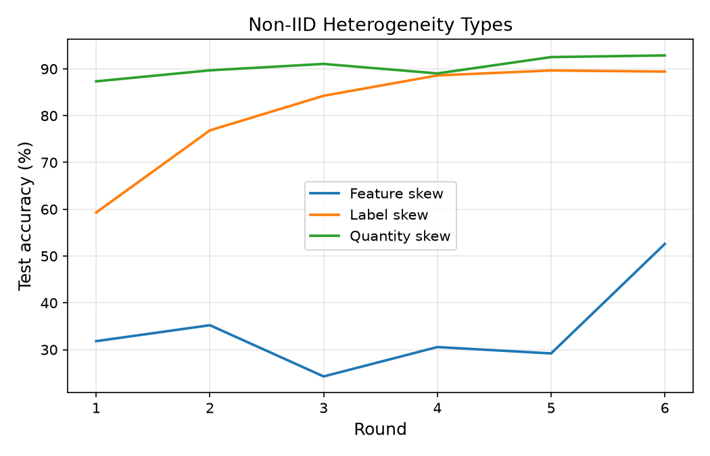

Feature skew (rotations) hurts accuracy much more than label or quantity skew. When input features change across silos, standard FedAvg needs normalization or personalization layers.

#### Unreliable clients and dropout
In mobile networks, clients drop out mid-round due to battery or poor connection. We test dropping clients with probability $p \in \{0.0, 0.2, 0.5\}$.

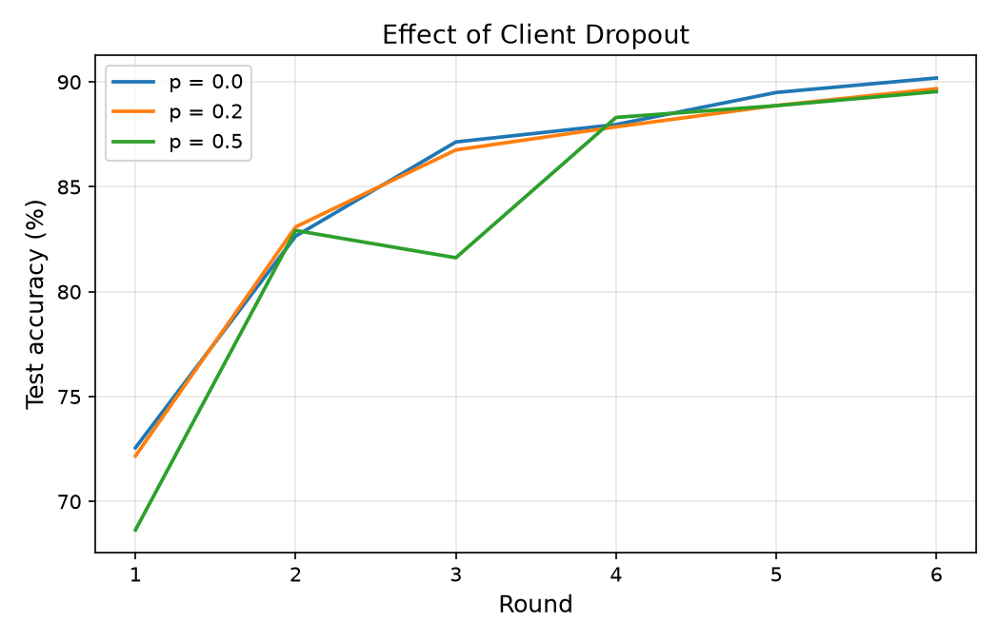

FedAvg handles random dropouts gracefully. While $p = 0.5$ slows convergence slightly, the global model still climbs steadily.

#### Communication cost
We calculate the actual bandwidth transferred: $\text{Bytes} = 2 \times |S_t| \times |\text{parameters}| \times 4\text{ bytes}$ (downloading and uploading float32 weights).

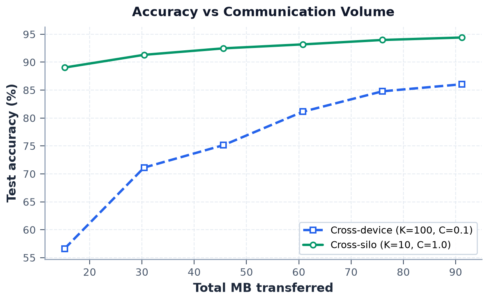

For TwoNN (199,210 params), a 10-client round transfers roughly 15.2 MB. Because cross-silo uses 100% of the data each round, it reaches high accuracy with fewer total megabytes transferred.

#### Measuring client drift directly
Why does non-IID data hurt FedAvg? We can see it by taking the update vectors $\Delta w_k = w_k - w_t$ of all clients in a round and calculating the average pairwise cosine similarity:

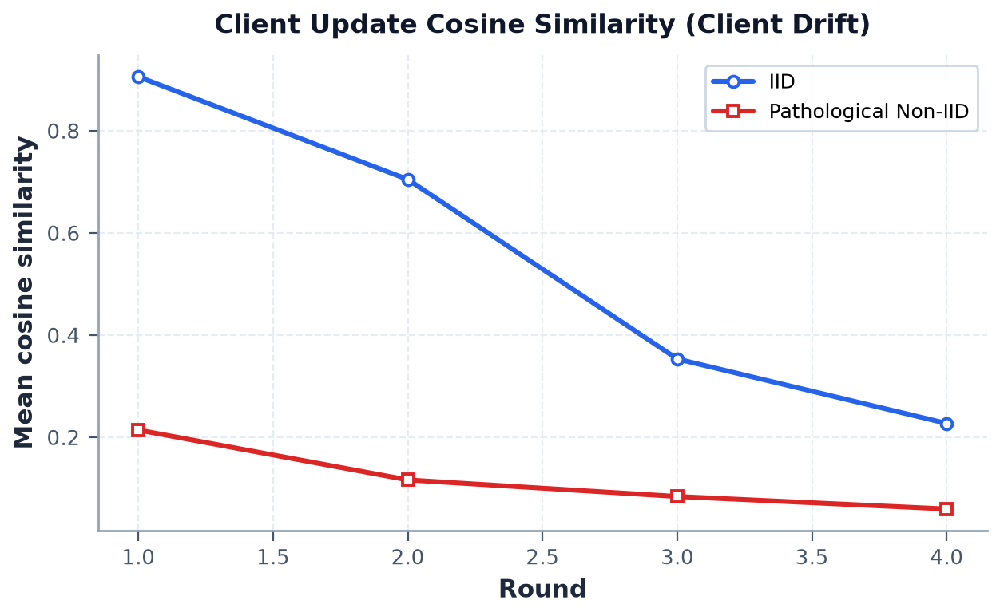

- **IID (blue):** Cosine similarity starts above 0.9. All clients agree on which direction to step.
- **Pathological non-IID (orange):** Cosine similarity starts around 0.2 and drops toward 0.05. Client updates are nearly perpendicular to each other.

This directly confirms **client drift**: each client descends toward its own private minimum, so their average cancels out useful progress.

---

## Practical Rules of Thumb

1. **Always share initial weights:** Never average models that started from different random seeds.
2. **More local steps help on IID data:** If client distributions are balanced, increase $E$ and decrease $B$ to save network communication.
3. **Watch out for high $E$ on skewed data:** If data is heavily non-IID, taking too many local steps causes client drift. Reduce $E$ or add regularization (like FedProx).
4. **Network bandwidth dictates the design:** In data centers with fast links, FedSGD converges reliably. On edge devices with limited bandwidth, FedAvg is essential.
5. **Feature skew is harder than label skew:** If clients see rotated or sensor-distorted images, standard weight averaging struggles and needs feature normalization or personalized layers.
